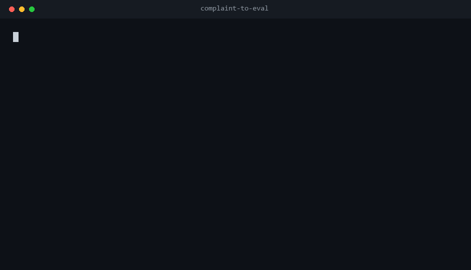

# complaint-to-eval

**Your users already wrote your eval set. You just never turned it into one.**

Turn raw complaints into **candidate triage labels** for AI tools: an
evidence-backed defect taxonomy, a quote from the report behind every finding, and
a diff between two versions. Deterministic, standard library only, no API key, no
model calls.

**It produces the raw material for a regression suite, not the suite.** A candidate
is a classified report plus the sentence that triggered it — *not* a runnable test
case. Turning that into something you can execute against a build is the human step
this project deliberately stops short of.



_Generated from a real `cte defects` run on the committed fixture by
`scripts/make_demo_gif.py`. Every line in the GIF is parsed from that run's
output — nothing is hand-typed, so you can reproduce it exactly._

```text
$ python -m complaint_to_eval defects --input tests/fixtures/defect_input.jsonl --synthetic --out out/defects
records=5 classified=4 unclassified=1 candidates=4 provenance=synthetic
```

[中文说明](README.zh-CN.md)

## Read this before trying it

This repo's most useful result so far is a **negative** one, and it is published in
full rather than buried:

| Claim | Status |
| --- | --- |
| "It finds failing behaviour interesting enough to test" | ⚠️ **Only for crashes.** 13 of 15 crash reports, 2 of 12 non-crash defects, on the newest random split. |
| "The mode labels are right" | ⚠️ **Unsettled.** Against model labels 0.71–0.77; against **four blind human readers** on one split, **0.23–0.38**. Readers agree strongly on *whether* something is broken (Fleiss κ = 0.922), not on *which* mode. |
| "Rewriting the annotation rule fixed the disagreement" | ❌ **Not tested yet.** One reader on a fresh split under the rewritten one-label rule scores the engine at 0.545 / 0.429. That is one person vs a machine — reader-to-reader agreement under the new rule needs a second person. |
| "It beats flagging everything" | ⚠️ **Only on precision, and only barely.** On a balanced 50/50 split: 0.632 precision / 0.600 recall, against **0.500 / 1.000** for "flag everything". |
| "Precision 0.94 means it is accurate" | ❌ That figure comes from a feed that is **90% defect reports**. Reweighted to a 25%-defect queue it is **0.36**. |
| "It produces a human-labelled eval set" | ❌ No. Two splits now have human labels (G: four readers; H: one reader), but `accepted_cases` is still `0`. |

Full method, seven rounds of numbers, misses, false positives and the prior-sensitivity
table: [`eval/defect_holdout/README.md`](eval/defect_holdout/README.md).

## What a candidate actually is

Nothing is executed, so nothing is verified. A real output row:

```json
{
  "id": "dcte-0001",
  "failure_mode": "ui_or_ux",
  "input": "Detail sidebar collapse drops keyboard focus.",
  "assertion": {"type": "must_not_reproduce_defect", "value": "ui_or_ux"},
  "evidence_record_id": "dify-45934",
  "status": "candidate",
  "human_review_required": true,
  "review": null
}
```

`input` is **the sentence from the report**, not a reproduction script. Every one of
the 123 candidates produced on the aider corpus has this shape: there is no input
you can feed to a build and get a pass/fail back. The value here is the triage —
mode, evidence, offsets — and the review queue it creates. If you need executable
cases, someone has to write them, and that someone is a human reading these rows.

## Why this exists

Teams that run agents already collect complaints: GitHub issues, support tickets,
app reviews, chat logs. Those complaints almost never become tests. Meanwhile the
downstream tooling is mature: [promptfoo](https://github.com/promptfoo/promptfoo)
and [Langfuse](https://github.com/langfuse/langfuse) will happily run an eval suite
and gate CI on it. The missing piece is upstream: **where does the suite come from,
and who decided that this complaint means this failure mode?**

This project works on that gap. It does not run evals. It produces the raw material
a human can turn into an eval set.

### What the first version got wrong (kept, not hidden)

v0.1 shipped eight **LLM-behaviour** modes (`wrong_fact`, `loop_cost`,
`context_loss`, …) written against a fabricated demo file. Run over **272 real
GitHub issues** (aider 136, dify 136, lobe 8), **1 of 81 strong signals** ever
appeared, and the original 191-issue snapshot produced a single candidate.

The cause was not only over-fitting to the demo. It is that **issue trackers of AI
tools are software defect trackers, not complaint corpora**: 79% of aider issues are
auto-filed crash reports, and dify issues are UI/config/data bugs. Nobody writes
"it hallucinated" in an issue tracker; they paste a traceback.

So the repo now carries two taxonomies. `cte run` keeps the original eight modes for
the feedback-shaped text they were designed for. `cte defects` classifies what
actually appears in trackers. The measurement above is for `cte defects`.

## Quickstart

No install needed:

```bash
git clone <this-repo> && cd complaint-to-eval
python -m complaint_to_eval demo
python -m complaint_to_eval defects --input issues.jsonl --real --out out/defects
```

Or install the `cte` command:

```bash
pip install .
cte defects --input issues.jsonl --real --out out/defects
```

`--real` is a declaration that you checked the licence and consent for that corpus.
Use `--synthetic` for fabricated data. Omitting both marks the report
`provenance: unspecified` and prints a warning.

## Input format

`.jsonl` or `.csv`. Lines starting with `//` are ignored.

```json
{"id":"r1","text":"Uncaught ImportError in main.py line 12.","source":"github-issues","product":"demo","version":"v1"}
```

Accepted text fields: `text`, `feedback`, `body`, `content`, `comment`.
Optional: `source`, `product`, `version`. Rows without text are skipped.

Personal data is redacted **before** classification and before anything is quoted.
Evidence offsets refer to the redacted text.

## Commands

| Command | Purpose |
| --- | --- |
| `cte demo` | run the built-in FABRICATED demo dataset |
| `cte run --input F --out D [--synthetic\|--real]` | LLM-behaviour modes (8) over feedback text |
| `cte defects --input F --out D [--synthetic\|--real]` | defect modes (10) over issue-tracker text |
| `cte diff --base A.json --head B.json` | diff two runs (candidates only) |
| `cte validate --labels F.jsonl` | check label-file structure |
| `cte taxonomy` | print the LLM-behaviour taxonomy and verify its invariants |
| `cte defect-taxonomy` | print the defect taxonomy and verify its invariants |
| `cte privacy --path DIR` | scan data files for residual personal data |

Both analysis commands emit `report.json` / `defects.json`, a Markdown twin, and
(for `run`) `promptfoo-candidates.json` — deliberately **not** a runnable promptfoo
config, because shipping unreviewed candidates straight into CI is the mistake this
project exists to prevent.

## The ten defect modes

| Mode | Fires on | Measured? |
| --- | --- | --- |
| `crash_or_error` | uncaught exception, traceback, crash, segfault | **yes** — 0.95–1.00 precision |
| `data_integrity` | lost, dropped, truncated, corrupted, miscounted data | weak |
| `logic_or_validation` | coercion, missing validation, duplicate run, wrong exit status | **no** — 0 of 5 caught on the clean split |
| `config_or_env` | env var / config ignored, install broken | weak |
| `ui_or_ux` | clipping, misalignment, blocked input, lost focus, stale render | weak |
| `i18n_or_locale` | missing/wrong translation, English fallback | too rare to measure |
| `security` | traversal, unauthorized action, bypass, arbitrary exec | too rare to measure |
| `performance` | slow, timeout, hang, leak | weak |
| `regression` | worked before, stopped working, regressed since a version | too rare to measure |
| `docs` | missing/undocumented setup step, README gap | too rare to measure |

Design rules, all enforced by tests: no bare topic nouns (a topic is not a claim);
negation scope cancels a hit ("no crash" is not a crash); fenced code and inline
code are blanked before matching, so a *quoted* `ValueError` is not a reported
crash; redaction happens first; one candidate per (record, mode).

## Scope: what this is not

- **Not an eval framework and not an observability platform.** It *feeds*
  promptfoo / Langfuse; it does not replace them.
- **Not an agent framework, harness, or memory layer.** Those positions are taken.
- **Not a release gate.** [release-contract](https://github.com/jian935/release-contract)
  decides whether a build can ship from offline evidence; this project decides what
  is worth testing in the first place. Upstream and downstream, with different
  inputs and outputs — no results or numbers are shared between them.
- **Not a requirement-to-test generator.** `responsibleai/ASSERT` starts from a
  requirements document; this starts from what users actually complained about.
- **Not a paper taxonomy.** MAST classifies multi-agent failures academically; this
  ships a versionable, reproducible pipeline around a draft taxonomy.
- **Not a continuation of the author's earlier projects.** `ai-claim-audit` audits
  numbers inside AI output, `experiment-copilot` decides whether an A/B result can
  ship, and `career-loop` matches JDs to experience. Different input, different
  output, different question. What carries over is the method.

## Honesty contract

1. Everything generated is an unreviewed **candidate**. `accepted_cases` is always
   `0`. One split carries human labels — that is a labelled split, not an accepted
   case set. See [`eval/defect_holdout/human_agreement.md`](eval/defect_holdout/human_agreement.md).
2. `complaint_to_eval/demo.jsonl` is **fabricated**. It was written to contain the
   exact phrases in the taxonomy, so a high hit count is a property of how the file
   was authored, not evidence of quality. Every report repeats this.
3. Precision/recall figures exist **only** in `eval/defect_holdout/README.md`, only
   for `cte defects`, and against **model-generated labels** (`annotator: model`) —
   never described as human accuracy — with **one exception**: split G has 39 human
   labels, scored separately in `human_agreement.md`. Quote the range, not one point, quote
   the trivial baselines alongside it, and **always state the class mix**: a
   precision measured on a 90%-defect feed is not a claim about a real queue.
4. Seven disjoint hold-out splits exist (A–G; G is the balanced 50/50 one). Once a
   split's misses have been read, that split is contaminated forever; every claim is
   measured on a split that no change had seen. Numbers are never overwritten.
5. `cte diff` compares matched phrases on candidates. It reports
   `resolved_candidates`, explicitly **not** a fix rate.
6. When human labels disagree with the rules, fix the labels, not the engine.
   Rules in [eval/ANNOTATION_GUIDE.md](eval/ANNOTATION_GUIDE.md).
7. Raw corpora belong in `.local/` (gitignored). Only aggregate numbers and redacted
   quotes belong in a public repo.

## Roadmap

| Stage | Deliverable |
| --- | --- |
| L1 (now) | single-purpose CLI plus an installable Agent Skill |
| L2 | 300 human-labelled cases, two annotators, agreement + confusion published, versioned accepted set in CI |
| L3 | community badcase submissions and a weekly regression report |

The known blocker before L2 is design, not effort: four rounds of adding, removing
and stripping signals left precision flat at 0.71–0.77. A phrase list cannot express
"topic word plus fault word in the same clause", which is what a human reader is
doing. That redesign is the next step, and it needs human labels to be judged at all.
In parallel the annotation procedure was rewritten (v2: one primary mode fixed by
symptom order); its effect on agreement between readers is still unmeasured — one
reader on a fresh split cannot establish it.

Contributions are welcome as **reverse tests**: a sentence the rules currently
misclassify plus the correct mode. Do not send a new keyword without a case showing
the failure and a precision check against a labelled split.

## License

MIT. Copyright (c) 2026 jian935.
