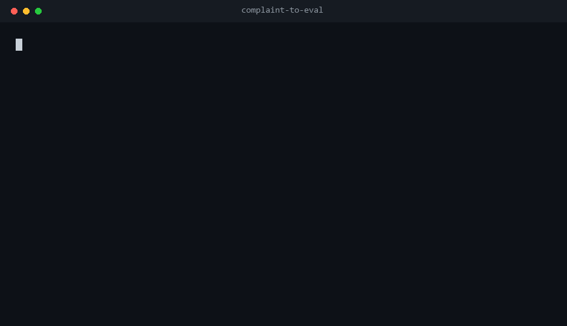

# complaint-to-eval

**用户早就把评测集写好了，只是你没把它变成评测集。**

把原始吐槽转成 AI 工具的**未人工复核的回归用例候选**：带原文证据的缺陷分类法、
每条发现对应的原文引句、以及两个版本之间的 diff。确定性规则、纯标准库、
零 API Key、不调用模型。



_由 `scripts/make_demo_gif.py` 直接抓真实 `cte demo` 输出渲染；gif 里的数字来自
那次真实运行，不是手敲的。_

```text
$ python -m complaint_to_eval demo
records=12 candidates=11 accepted=0
provenance=synthetic (FABRICATED; demo artefact only, never a metric)
```

## 用之前先看这段

这个仓库目前最有价值的结论是**一个负结果**，而且完整公开、没有藏起来：

| 声称 | 实际状态 |
| --- | --- |
| 「能找出值得测的失败行为」 | ⚠️ **只对崩溃类成立**。最新干净集上：15 条崩溃抓到 13 条，12 条非崩溃缺陷只抓到 2 条。 |
| 「类别判得对」 | ⚠️ 四套干净集上模式级精确率 0.71–0.77，**四轮改信号没有推动它**。 |
| 「比无脑全标记强」 | ⚠️ **只在精确率上强**。无脑全标记召回 1.000，本项目做不到。 |
| 「产出了人工标注的评测集」 | ❌ 没有。`accepted_cases` 恒为 `0`，产出全是候选。 |

完整方法、六轮数字、漏判与误报清单见
[`eval/defect_holdout/README.md`](eval/defect_holdout/README.md)。

## 为什么做这个

用 Agent 的团队都在收集吐槽：GitHub issues、客服工单、应用评论、对话日志。
但这些吐槽几乎从没变成测试。下游工具其实已经很成熟：promptfoo、Langfuse
能跑评测集、能进 CI 门禁。缺的是上游：**评测集从哪来，谁判定「这条吐槽属于这类缺陷」？**

本项目补这一段。它不跑评测，只产出「人类可以据此整理成评测集」的原料。

### 第一版错在哪（留着，不删）

v0.1 交的是 8 类 **LLM 行为**模式（`wrong_fact`、`loop_cost`、`context_loss` …），
而且是照着编造的 demo 文件写的。拿它跑 **272 条真实 GitHub issue**
（aider 136、dify 136、lobe 8）：**81 个强信号里只有 1 个出现过**；
最初的 191 条快照只产出 1 个候选。

原因不只是词表过拟合，而是**AI 工具的 issue 区是软件缺陷追踪器，不是抱怨语料**：
aider 的 issue 有 79% 是自动提交的崩溃报告，dify 的是 UI / 配置 / 数据 bug。
没人会在 issue 里写「它幻觉了」，他们直接贴 traceback。

所以仓库现在有两套分类法：`cte run` 保留原来那 8 类，用于它们本来针对的反馈式文本；
`cte defects` 分类真实出现的东西。上面那张测量表是 `cte defects` 的。

## 快速开始

无需安装：

```bash
git clone <this-repo> && cd complaint-to-eval
python -m complaint_to_eval demo
python -m complaint_to_eval defects --input issues.jsonl --real --out out/defects
```

或安装 `cte` 命令：

```bash
pip install .
cte defects --input issues.jsonl --real --out out/defects
```

`--real` 是声明「已核对语料的许可与授权」；编造数据用 `--synthetic`。
两者都不写会被标成 `provenance: unspecified` 并打印警告。

## 输入格式

`.jsonl` 或 `.csv`，`//` 开头的行会被忽略。

```json
{"id":"r1","text":"Uncaught ImportError in main.py line 12.","source":"github-issues","product":"demo","version":"v1"}
```

正文字段可用 `text` / `feedback` / `body` / `content` / `comment`；
可选 `source` / `product` / `version`；没有正文的行跳过。

**脱敏发生在分类和引用之前**，证据里的偏移量指的是脱敏后的文本。

## 命令

| 命令 | 用途 |
| --- | --- |
| `cte demo` | 跑内置**编造**示例数据 |
| `cte run --input F --out D [--synthetic\|--real]` | 8 类 LLM 行为模式，用于反馈式文本 |
| `cte defects --input F --out D [--synthetic\|--real]` | 10 类缺陷模式，用于 issue 追踪器文本 |
| `cte diff --base A.json --head B.json` | 对比两次运行（仅 candidate） |
| `cte validate --labels F.jsonl` | 检查标注文件结构 |
| `cte taxonomy` | 打印 LLM 行为分类法并校验不变量 |
| `cte defect-taxonomy` | 打印缺陷分类法并校验不变量 |
| `cte privacy --path DIR` | 扫描数据文件里残留的个人信息 |

`run` 另外产出 `promptfoo-candidates.json`，故意**不是**可运行的 promptfoo 配置——
把未复核的 candidate 直接塞进 CI，正是本项目要反对的做法。

## 十类缺陷

| 类别 | 命中什么 | 测过吗 |
| --- | --- | --- |
| `crash_or_error` | 未捕获异常、traceback、崩溃、段错误 | **测过**，精确率 0.95–1.00 |
| `data_integrity` | 数据丢失、截断、损坏、漏计 | 弱 |
| `logic_or_validation` | 类型强转、校验缺失、重复执行、退出码错 | **没测住**——干净集上 5 条抓到 0 条 |
| `config_or_env` | 环境变量 / 配置不生效、安装坏 | 弱 |
| `ui_or_ux` | 遮挡、错位、点击被挡、焦点丢失、显示不更新 | 弱 |
| `i18n_or_locale` | 漏翻、翻错、回退英文 | 样本太少，测不了 |
| `security` | 路径穿越、越权、绕过确认、任意执行 | 样本太少，测不了 |
| `performance` | 慢、超时、卡死、泄漏 | 弱 |
| `regression` | 以前正常、某个版本后坏了 | 样本太少，测不了 |
| `docs` | 缺文档、README 缺步骤 | 样本太少，测不了 |

设计纪律（全部有测试锁住）：**不许裸话题词**（话题不是投诉）；否定辖域取消命中
（「没有崩溃」不算崩溃）；匹配前先把代码块和行内代码抹成空格，所以**引用**出来的
`ValueError` 不算「报告了崩溃」；脱敏先行；每条记录的每个类别只出一个候选。

## 边界：它不是什么

- **不是评测框架，也不是可观测平台**。它给 promptfoo / Langfuse 喂数据，不替代它们。
- **不是 Agent 框架、harness 或记忆层**，那些位置已经没有缝隙。
- **不是发布门禁**：[release-contract](https://github.com/jian935/release-contract)
  负责判断「基于离线证据能不能发」，本项目负责回答「该测什么」。两者是上下游，
  输入与产出都不同，互不引用对方的结论或数字。
- **不是「需求文档 → 测试用例」生成器**：ASSERT 从需求出发，本项目从用户真实不满出发。
- **不是论文分类法**：MAST 是学术分类，本项目交的是可运行、可版本化、可复跑的流水线。
- **不是作者旧项目的延续**：`ai-claim-audit` 审 AI 输出里的数字，
  `experiment-copilot` 判 A/B 实验能不能上线，`career-loop` 做 JD×经历匹配。
  输入、产出、要回答的问题都不同。迁移过来的是方法。

## 诚实边界

1. 产出全部是未复核的 **candidate**；没有人工标注，`accepted_cases` 恒为 `0`。
2. `complaint_to_eval/demo.jsonl` 是**编造的**，而且刻意写进了分类法里的原词，
   所以命中数高是文件写法决定的，不是能力证明。每份报告都会重复这句。
3. 精确率 / 召回率**只**存在于 `eval/defect_holdout/README.md`，只针对 `cte defects`，
   而且只对**模型标注**（`annotator: model`）——绝不描述成人工准确率。
   引用时必须给区间而不是单点，并且和无脑基线一起引。
4. 现在有 A–F **六套互不相交**的 hold-out。某一套的漏判一旦被读过，那套就永久污染；
   所有结论都在「没有任何改动看过」的那套上测。旧数字不覆盖、不删除。
5. `cte diff` 比的是 candidate 上命中的短语，报的是 `resolved_candidates`，
   明确**不是**修复率。
6. 人工标注与规则冲突时，**改标注，不改引擎**。完整规则见
   [eval/ANNOTATION_GUIDE.md](eval/ANNOTATION_GUIDE.md)。
7. 原始语料放 `.local/`（已 gitignore）；公开仓库只放聚合数字与脱敏后的引用。

## 路线

| 阶段 | 交付 |
| --- | --- |
| L1（当前） | 单点 CLI + 可安装的 Agent Skill |
| L2 | 300 条人工标注、双标注者、公开一致性与混淆矩阵、版本化 accepted 集进 CI |
| L3 | 社区提交 badcase + 每周回归报告 |

进 L2 之前真正的阻碍不是工作量，是设计：四轮「加词、删词、抹代码」之后精确率一直停在
0.71–0.77。短语表表达不了「同一句里既有话题词又有故障词」，而这正是人读报告时在做的事。
这个重构是下一步，而它要先有人工标注才能被评判。

L1 阶段最欢迎的贡献是**反向测试**：给一句当前规则判错的文本，附上正确类别。
不要只丢一个新关键词——必须带上失败样例和基于标注集的精确率检查；
泛词靠同行语境约束解决，不靠加词。

## 许可

MIT · Copyright (c) 2026 jian935
